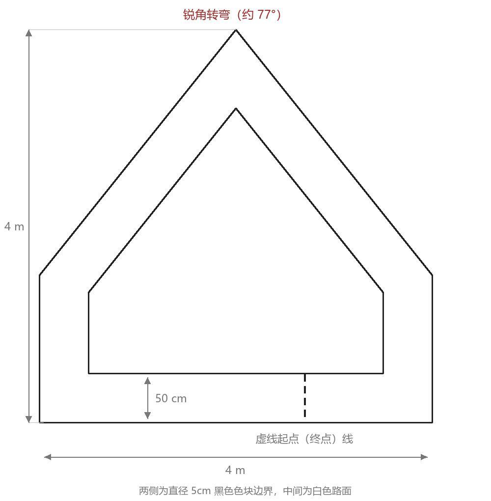

# 比赛文档（Markdown 转写版）

来源：[比赛文档.pdf](比赛文档.pdf)，共 6 页。转写及核对日期：2026-10-26（北京时间）。维护：比赛资料整理对话转写，00 后续维护入口，正式规则解释以主办方为准。

本文件完整转写原通知正文，合并分页断行，将评分表转换为 Markdown 表格，并保留赛道原图；省略重复页眉标志和页脚页码。以下“原文开始”至“原文结束”为通知内容，转写说明另列于文末。与 PDF 有差异时以 PDF 原文为准；后续正式补充通知须留存来源并明确适用条款。

<!-- 原文开始 -->

# 关于开展 2026 年深圳大学电子与信息工程学院“中国电信杯”椰椰智能小车设计竞赛的通知

深圳大学电子与信息工程学院创新创业教育中心 深圳大学电子协会硬件部

2026年10月9日

<!-- 原 PDF 第 1 页 -->

为了给学院内广大新生及专业学子提供一个展示才华、交流技艺的平台，帮助同学们在项目中提高自身的电子设计能力，加强团队合作意识，并为即将到来的2027年全国大学生电子设计竞赛国赛做好充分准备，深圳大学电子与信息工程学院创新创业教育中心联合深圳大学电子协会共同举办“中国电信杯”椰椰智能小车设计竞赛。

通过参与本次竞赛，同学们不仅能够锻炼自身的专业技能，还能在实践中发现问题、解决问题，培养出更加扎实和全面的电子设计素养。同时，学院也将借助此次竞赛的机会，发现优秀团队和个人，为同学们提供进一步的指导和支持，助力同学们在未来的电子设计领域取得更加辉煌的成就。现就有关事宜通知如下：

## 一、赛道与组别

本次竞赛共设定一个赛道，为“智能小车”赛道。赛道为一条闭合的环形车道，两侧以黑色色块标示边界，中间为白色路面。

## 二、竞赛参加对象

参加竞赛的对象需要满足以下要求（符合以下两项条件之一者）：

1. 深圳大学2026届学生
2. 往届的深圳大学电子协会干事（以指导身份参赛）

<!-- 原 PDF 第 2 页；项目要求跨至第 3 页 -->

## 三、参赛作品要求

智能小车赛道：

### 1. 项目要求

设计制作一个由程序控制的小车，传感器不限。小车在规定的平面跑道上自动按顺时针方向完成一整圈行驶。跑道为一条闭合的环形车道，两侧边界由连续排列的黑色色块构成，中间路面为白色，车道净宽 50cm；车道至少包含一个锐角转弯。赛道铺设于 4m × 4m 的平整场地内，具体形状与尺寸见图 1。

图1 智能小车跑道

赛道内以虚线标出起点（终点）线。测评开始前，由参赛队员将小车人工放置于该虚线起点处，车头朝向行驶方向。任务为沿黑色边界所围成的环形车道自动完成一整圈行驶，完成一圈的总时长不得超过 5 分钟，用时越短则对应得分越高。小车运行过程中垂直投影必须始终处于环形车道区域之内，若垂直投影完全脱离该区域，即判定此次测试失败。

<!-- 以下为原 PDF 第 3 页内容 -->

小车垂直投影每与黑色边界标识发生接触一次，将从基础分总分中进行一次扣除；若小车垂直投影自始至终持续与黑色边界标识接触直至完成一圈，则此项基础分计为零分。

语音指挥为独立设置的额外功能。参赛队员须在赛场指定的发令点以语音指令操控小车完成以下任务：

（1）语音启动：小车置于虚线起点处后，队员发出启动指令，小车据此出发；

（2）语音接管：小车冲过终点线后，发出接管指令，小车须在 3 秒内减速停稳；

（3）语音应答：小车须以语音方式就上述指令作出应答，应答内容可自定且须清晰可辨；

（4）自选指令，参赛队可自行设计不少于 2 条语音指令并现场演示自身创意。上述语音识别与应答须由小车独立完成，不得以人工按键、无线遥控等方式替代。

小车垂直投影越过终点线后，若能自动减速并停稳，作为额外功能予以加分；未实现自动停车的队伍不因此扣分。在满足上述额定功能要求的基础上，若小车具备其他额外能力，可依据其技术创新性与实用性予以相应加分。

### 2. 关于小车和场地的要求

小车尺寸限制为长不超过30cm，宽不超过20cm，高不超过25cm。小车总重量不得超过5kg（包括电池等所有部件）。必须使用可充电电池作为动力源，禁止使用汽油等易燃易爆物品。允许使用任何类型的传感器。

行驶场地水平铺设于平整的地面，除题目要求的赛道标识之外，行驶场地上不得有其他任何指示标记。不得对测试场地外环境有任何要求。为了适应测试场地，允许测试前小车试跑。

测评开始前，小车可手动放置到虚线起点处，手动一键启动后出发。场地内外不得架设任何其他装置设备。正式测试时，小车行驶过程中不得人为干涉、遥控小车运动。测试时，应允许相关人员在场地外围走动。

<!-- 原 PDF 第 4 页 -->

### 3. 关于参赛队伍的要求

学生采用自愿组合，三人一队的原则组成参赛队，组成队伍后由队伍队长填写报名问卷。

队伍成员要求全部由深圳大学2026届学生组成（可跨院，但队长须是电信学院），可以邀请一位往届的深圳大学电子协会干事作为队伍指导，同一位队伍指导最多可以指导2支队伍，队伍指导不参与队伍成员数量计算。指导和参赛队员共同获得竞赛奖品。

竞赛评分表如下：

| 类别 | 项目 | 主要内容 | 满分 |
| --- | --- | --- | ---: |
| 最终报告 | 系统方案 | 小车行驶及语音交互方案 | 3 |
| 最终报告 | 理论分析 | 论证方案可行性 | 5 |
| 最终报告 | 电路与程序设计 | 控制电路、语音链路及程序流程 | 5 |
| 最终报告 | 报告结构及规范 | | 7 |
| 要求 | 基本功能实现 | 沿环形车道完成一圈，按用时折算 | 60 |
| 要求 | 额外功能实现 | 语音启动、接管、应答、自选指令及冲线自动停车 | 40 |
| 总分 | | | 120 |

表 1 竞赛评分表

## 四、赛程安排（验收暂定为12月5日）

### 1. 报名

请各队伍队长在【10月25日23:59前】填写 2026 深圳大学电子与信息工程学院“椰椰杯”智能小车设计竞赛报名问卷，按照要求填写相关内容。

<!-- 原 PDF 第 5 页 -->

### 2. 决赛

决赛时间为暂定为12月5日（拟定）。具体竞赛时间通过赛事群另行通知。决赛验收通过线下答辩与现场实测、评委老师评审打分的形式进行。

## 五、特别声明

1. 主办单位将对作者和作品的资格进行审查，对于不符合竞赛资格或弄虚作假者，一经查实，立刻取消其竞赛资格；对已获奖者将追回所得一切奖励及荣誉，并以适当形式公示。
2. 作品产权应归属竞赛者所有，知识产权须明晰，无权属纠纷。竞赛者与发明创造或专利技术持有人的一切纠纷与深圳大学电子与信息工程学院创新创业教育中心和深圳大学电子协会无关。
3. 竞赛期间，参赛学生可以使用各种图书资料和网络资源，但不得以任何方式与队伍外人员进行讨论交流，教师和其他非参赛队员应回避。
4. 在竞赛中如发现有教师参与、他人代做、抄袭及被抄袭、队与队之间交流、不按规定时间发题和收交作品等现象，将取消获奖，情节严重者将通报批评。
5. 竞赛的最终解释权归深圳大学电子与信息工程学院创新创业教育中心和深圳大学电子协会硬件部所有。

## 六、竞赛证书与奖品

竞赛共设置两个特殊奖项和三档等级奖励

最佳技术奖。最佳技术奖旨在表彰在基本功能和额外功能实现上具有突出表现的团队，奖品包含一座最佳技术奖奖杯与获奖证书。

最佳创意奖。最佳创意奖旨在表彰在自身项目实现上独具创新的团队，奖品包含一座最佳技术奖奖杯与获奖证书。

一等奖，二等奖，三等奖。根据最终评委的打分，将向除获得特殊奖项的队伍提供依据评分排序的等级奖，奖品包含获奖证书与奖品。获得一等奖队伍数量原则上不超过总参赛队伍的10%，获得二等奖的队伍数量原则上不超过总参赛队伍的30%。其余队伍将都会获得三等奖。

<!-- 以上等级奖段落跨原 PDF 第 5—6 页；以下为第 6 页 -->

所有的参赛团队并完成竞赛验收的团队都会得到参赛纪念品。

加群二维码：已超200人，请联系在群同学入群，或咨询电协相关人员。

全国大学生电子设计竞赛（National Undergraduate Electronics Design Contest）是教育部和工信部共同发起的大学生学科竞赛之一，该竞赛是面向大学生群众性科技活动，目的在于推动高等学校促进信息与电子类学科课程体系和课程内容改革。竞赛的特点是与高等学校相关专业的课程体系和课程内容改革密切结合，以推动课程教学、教学改革和实验室建设工作。

深圳大学电子协会硬件部 深圳大学电子与信息工程学院创新创业教育中心

<!-- 原文结束 -->

---

## 转写说明（非主办方新增规则）

- 评分表原首列表头为空，此处补“类别”便于阅读，并展开原表合并单元格。报告分项合计 20 分，基本功能 60 分，额外功能 40 分，总分 120 分。
- 图 1 直接提取自 PDF 第 2 页，保留原图标注：4 m × 4 m、净宽 50 cm、锐角转弯约 77°、两侧直径 5 cm 黑色色块边界、虚线起点（终点）线。
- 原文未给出用时折算公式、每次碰线的具体扣分、额外功能 40 分的分项分值，以及其他创新能力加分的具体细则或上限。相关数值和判定细节须依据主办方正式说明，项目自行制定的测试指标须标为队内指标。
- 原文中的“2026届”、最佳创意奖段落所写的“最佳技术奖奖杯”等表述均按原文保留，不擅自修正。
- 2026-10-26 已逐页查看 6 页原 PDF 渲染图，并核对全文、图 1 和表 1。自动比对去除空白及 Markdown 格式后的正文共 2728 字符，与 PDF 提取正文完全一致；评分表 7 行逐项一致，赛道图与 PDF 内嵌图像字节一致，本地链接及 UTF-8 编码检查通过。此为转写检查，不代表当前小车已符合全部比赛要求或已通过实测验收。
- 原 PDF SHA-256：`e7af6ca7eee908ae5460710f1f91d0658c401de208e9e3e570d48d76fe45931d`。
