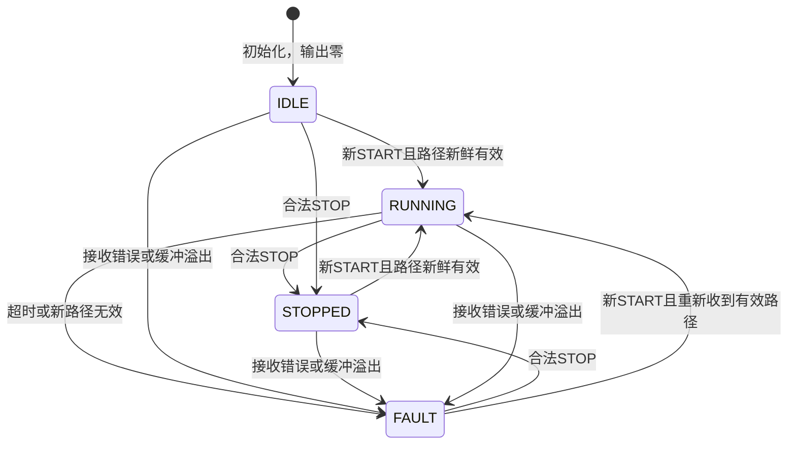

# 主控状态机与接入边界

CAR_IDLE=0、CAR_RUNNING=1、CAR_STOPPED=2、CAR_FAULT=3。只有RUNNING产生非零演示请求，其他状态输出零。

| 场景 | 主控行为 |
| --- | --- |
| 开机、仅收到路径 | 留在IDLE，不自行启动 |
| START先到、没有有效路径 | 拒绝启动，不保留等待启动事件 |
| 正常运行 | 5ms调度更新左右请求，未实现速度闭环 |
| 新路径无效/低置信度/处理过慢 | 立即FAULT，请求清零 |
| 新鲜路径超过200ms未更新 | FAULT，请求清零 |
| UART硬件错误、缓冲溢出 | 清理接收并FAULT，原路径失效 |
| 恢复有效数据 | 保持停止，必须有新的显式START |
| 终点候选 | 记录，不直接停机；一圈判定后续接入 |

演示请求范围30..170（千分比形式），基础120，bend>500时基础80，转向修正error/20。右偏为正时左轮请求增加、右轮减少。该比例只是软件演示，不是实车PWM、速度或PID调参结果。

到货后顺序：主控与硬件确认引脚 → 悬空电机启停 → 编码器方向与计数 → 左右速度闭环 → 接入视觉转向 → 低速试跑 → 丢线与断连实测 → 一圈判定与语音动作反馈。板级驱动需将停止请求实现为实际停车，制动/滑行按驱动器资料和实测决定。
