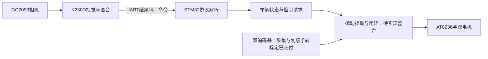

# 系统架构与软件分层

2026-10-30补充：[SpeedMatch](../control/docs/speed_match.md)已新增独立双轮同速台架，纯PI在Algorithms/Speed，校准／轮速策略在App/Motion，复用原Drivers_Custom编码器和PWM。当前仅软件／模型交付，实车稳定性待验；后文“速度PID尚未实现”属于原10月25日状态，现以此补充区分独立PI已实现与HardwareBench／整车闭环尚未整合。全项目验收仍由00汇总。

2026-10-29安装变更：主控已换左右轮并重新命名物理A左／B右，旧前进转向在新位置成为后退；当前资源到物理轮的对应及参数沿用统一见[当前轮位](../hardware_preparation/wheel_mapping.md)。新物理A/B不等同驱动插口MOTOR-A/B或编码器软件a/b；原始软件通道不随命名自动改动，当前实际配对待核。本次不改固件／引脚，不把旧安装的手转或桥级转停证据外推为新安装动力通过。


日期：2026-10-25（北京时间）。维护：00协调架构，01维护STM32，视觉／硬件各维护对应实现。
依据：当前源码、六目标Keil配置、[模块状态](../project_planning/project_status.md)及主控确认的目录分层。以下区分现有实现与后续模块。

## 整车数据流



该图描述系统连接方向，不代表完整链路已经验收。视觉正式脚本尚未在本仓库归档；HardwareBench的左右请求仍是演示值，编码器采集与初版手转标定已交付，速度PID尚未实现。当前电机诊断使用独立目标，不经过整车状态机。2026-10-25主控已确认MotorPwm的A/B分别起转与自动停转；[C-02C](../project_planning/tasks/C-02C.md)已交付双编码器采集及初版标定，接续[C-02D](../project_planning/tasks/C-02D.md)封装运动Module与低速闭环；完整链路待实测。

## 仓库与主控工程的两层结构

```text
yeye/
├── AGENTS.md                     所有对话共同规则
├── README.md
├── docs/                         整车主题文档入口
├── control/                      STM32主控，01负责
│   ├── Core/
│   │   ├── Inc/stm32f4xx_conf.h  SPL模块配置
│   │   ├── Src/                  main及各独立目标入口
│   │   └── Startup/              F407启动汇编及许可
│   ├── App/
│   │   ├── Car/                  car.c/h：车辆状态与演示请求
│   │   └── Diagnostics/          motor_bench.c/h：纯诊断状态机
│   ├── Drivers_Custom/
│   │   ├── Board/                board.c/h：时钟、滴答、UART与板级适配
│   │   ├── Motor/                PWM台架／GPIO诊断驱动
│   │   └── Communication/        protocol.c/h：字节包编解码
│   ├── Drivers/                  原版CMSIS、STM32定义与SPL
│   ├── Algorithms/               Encoder计数、回绕与时间换算纯算法
│   ├── Tests/Host/               电脑测试及fake硬件边界
│   ├── MDK-ARM/                  多目标／独立Direct工程和本机调试配置
│   ├── tools/                    现有构建／测试脚本
│   ├── docs/                     主控技术规范与历史交付
│   └── build/                    本机编译输出，Git忽略
├── vision/                       视觉与语音，由视觉负责
├── hardware_preparation/         硬件、供电与装配资料
├── testing/                      带版本与日期的现场证据
├── project_planning/             协作、状态、任务和规划历史
├── competition/                  原始赛事文件
└── report/                       报告与最终提交
```

仓库路径仍为D:/Projects/yeye，没有改名或生成另一份工程。原control/firmware仅保留历史本机缓存与迁移说明；唯一可编辑源码和正式工程已迁到上述位置。

## 分层边界

| 层 | 负责什么 | 当前边界 |
| --- | --- | --- |
| Core | 选择入口、初始化、调度和中断衔接 | 保留原入口与保护流程，不改变六目标行为 |
| App | 车辆与诊断流程，使用模块接口推进状态 | car.c尚不构成速度闭环；诊断逻辑与整车逻辑独立 |
| Drivers_Custom | 主控自行实现的板级、通信、电机适配 | board.c内部UART本轮整体保留，未来有明确任务再拆分 |
| Drivers | 外部芯片／内核库 | 仅迁路径，厂家源码字节与来源哈希保留 |
| Algorithms | 与外设寄存器无关、可独立测试的数学算法 | PID、tracking尚未实现，不创建假实现或空API |
| Tests | 电脑验证真实逻辑与硬件边界模型 | 不验证真实电压、波形、电机或整车表现 |
| MDK-ARM | 设备、宏、目标排除、编译与调试配置 | SPL／ARMCC5沿用，CubeMX的.ioc不适用于当前来源 |

现有编码器驱动已在Drivers_Custom/Encoder，后续传感器驱动放对应Drivers_Custom目录；纯PID数学放Algorithms，轮速采样／PWM仍在驱动，车辆策略在App。目录说明不是新增功能任务。

## 六个现有目标

| Keil目标 | Core/Src入口 | 用途 |
| --- | --- | --- |
| LogicDemo | logic_demo.c | 无硬件协议与状态机演示 |
| HardwareBench | main.c | 串口／状态机主框架，UART默认关闭、请求输出待适配 |
| BoardSelfTest | board_self_test.c | 独立板级双闪与基础自检 |
| MotorBench | motor_bench_main.c | PWM人工阶段诊断 |
| MotorContinuous | motor_bench_main.c＋持续目标宏 | A桥持续诊断 |
| MotorDirect | motor_direct_main.c | GPIO人工单次A诊断 |

另外保留MotorDirectB、MotorPwm与EncoderBench独立工程；MotorPwm与MotorBench复用重写后的PWM入口，不能因其不在原六目标下拉框中便打开旧工程。当前独立入口按control/README.md选择。多个main由Keil逐目标显式排除，不能将Core/Src所有文件直接一起编译。对话职责继续由[协作标准](../project_planning/collaboration_standard.md)规定。
