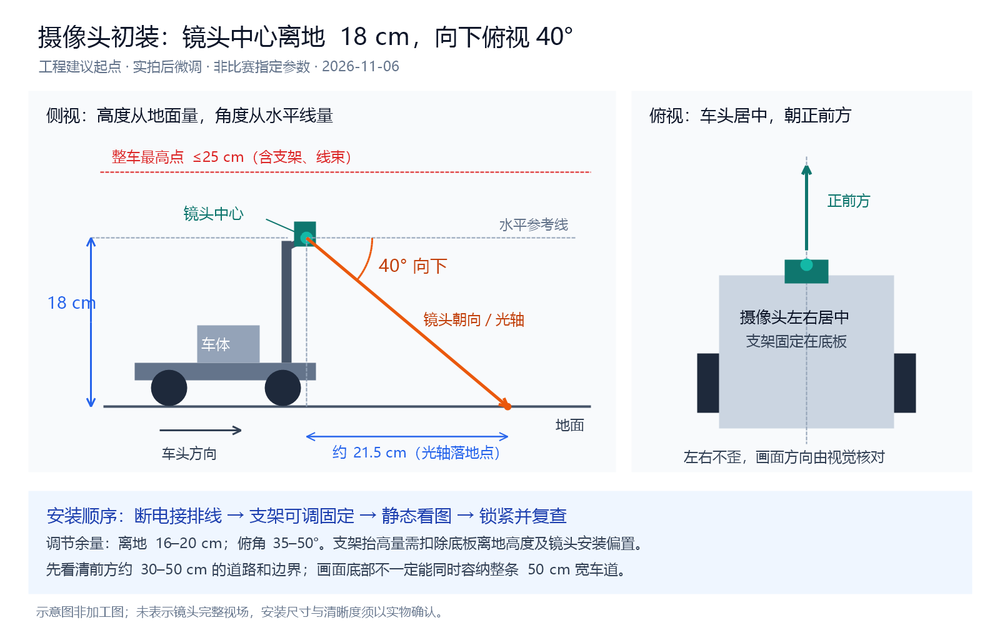

# 摄像头初装与视场确认

日期：2026-11-06。依据：主控反馈新摄像头到货并要求安装高度、角度与示意图；比赛第三部分、图1和评分表；现有[视觉方向建议](../vision/references/recognition_direction_2026-11-01.md)与[底板记录](chassis_record.md)。硬件负责结构与排线固定，视觉负责图像方向、清晰度及实际视场，主控／02记录装车和后续行驶结果。

适用范围：先按项目已有 Lite-K230D-CanMV＋GC2093 给出可调整初装建议。主控本轮没有说明新摄像头是否更换型号／镜头；确认问题已提出，尚无回复，不据此认定仍是原镜头。其他型号可参考机械位置，但接口、排线与软件必须按实际产品另核对。本页完成资料建议，不代表已装车或已通过采图／循迹。

## 1. 可以先照此搭支架

| 参数 | 初装建议 | 如何量／核对 |
| --- | --- | --- |
| 镜头中心离地 | **180 mm**；预留160–200 mm调节范围 | 车轮着地、车体正常承重，从地面竖直量到镜头中心，不从底板量 |
| 光轴俯角 | **相对水平向下40°**；预留35–50° | 镜头朝向与水平面的夹角；不是默认相机PCB或支架板与地面的夹角 |
| 左右位置 | 车身纵向中心线上 | 以车身中心线为准，不以K230板上的接口位置为准 |
| 前后位置 | 底板前部、镜头前无遮挡 | 尽量留在车体前端包络内，检查下沿视线不被底板、保险杠或线束挡住 |
| 左右偏航、侧倾 | 尽量为0° | 朝车头正前方；车辆居中时道路呈正常透视，画面左右不旋转倾斜 |

这些数值是待实拍确认的工程起点，比赛没有规定相机必须装在18 cm或40°。若镜头中心为18 cm，支架、相机外壳和线束的最高点仍须逐一测量，整车最高不得超过25 cm；长≤30 cm、宽≤20 cm、含电池总重≤5 kg也须满足。

支架所需抬高量＝180 mm－底板上表面离地高度，再扣除安装孔／转轴到镜头中心的竖直偏置。不能直接购买“18 cm支架”就认为镜头离地18 cm。优先用两侧支撑或有斜撑的刚性立柱，加可调俯仰支架；避免只靠排线、软胶或多节细铜柱支撑。现有孔位／槽位优先，实际孔距和板厚未确认前不指定螺钉长度或直接加工。

[矢量图](camera_mount_diagram.svg)由[source/generate_camera_mount_diagram.ps1](source/generate_camera_mount_diagram.ps1)生成。左图光轴按18 cm／40°作图，右图仅说明居中方向；不表示实际镜头完整视场，也不是加工图。

## 2. 断电装配步骤

1. **硬件断开车辆电池与K230的USB等所有供电**，先确认实际摄像头与板卡兼容。立创官方说明庐山派默认摄像头座为CSI2、22P／0.5 mm；其他厂家的GC2093不能仅凭感光芯片同名判断排线兼容。
2. **硬件连接排线**：按实际接口的插拔／锁扣结构操作，对照该板卡与镜头厂家图确认金属触点方向；排线插正到位，需锁扣的接口再锁紧。不用蓝色补强片朝向推断所有接口的接法，不带电插拔，不硬掰座子。
3. **硬件先固定支架，再固定相机**：使用实际匹配安装孔／夹具；金属支架与裸露电路焊点绝缘，螺钉不顶到PCB元件。调到镜头中心18 cm、光轴向下40°，先保留微调空间。相机与支架不能随手轻触就明显摆动。
4. **硬件整理排线**：留一段缓弯供俯仰调节，固定在支架上作应力释放，不让排线承重或拉拽连接器；避开车轮、齿轮、底板锐边和散热器高温区域。按接口实际位置走线，不为让排线笔直而把镜头移离车身中心。
5. **视觉沿用已能采图的供电和脚本检查画面**，本次不顺带改车载供电。装配时可以在实验台接电脑预览；正式比赛须按规则使用车载独立系统。相机经FPC接K230，图像不直接接STM32，结果包仍按现有UART协议另行联调。
6. **视觉与硬件微调、锁紧并复查**：可调焦镜头对准实际前方路面上的5 cm黑色块，缓慢旋转到目标距离清晰，避免把镜头旋出。固定焦点的小镜头不要强拧。锁紧后保存实际高度、俯角、镜头型号与脚本图像尺寸；改变安装位置、镜头或裁剪后，原ROI／透视标定要重新核对。

厂家接口及镜头依据：[立创官方《使用摄像头》§2、§3](https://wiki.lckfb.com/zh-hans/lushan-pi-k230/image-recog/use-sensor.html)，[官方快速上手](https://wiki.lckfb.com/zh-hans/lushan-pi-k230/quick-start.html)。2026-11-06在线查阅。接口触点具体朝向以实际板卡及厂家对应图为准，本页不在缺少实物照片时猜测。

## 3. 为什么需要实拍再定角度

18 cm、40°时，光轴与地面交点在镜头地面投影前方约21.5 cm：`x = h / tan(俯角)`。这只是画面中心朝向地面的落点，不是最远可见距离，也不是算法必须使用的预瞄距离；从车头量还须计入相机相对车头的前后位置。

立创官方列出的小镜头版视场为H65°／V40°（定焦70 cm），可旋转调焦大镜头版为H86°／V55°。相同GC2093芯片可配不同镜头，因此不能按芯片名直接确定视场。以下为平地、理想针孔、无裁剪且有效视场符合厂家标称时的几何估算，真实清晰度和可用区域另验：

| 镜头 | 18 cm／40°时中心纵截面的地面近远范围 | 本车需要注意 |
| --- | --- | --- |
| 小镜头V40° | 投影点前方约10–49 cm | 近处可能模糊或横向覆盖不足；不能承诺近处50 cm道路全宽同时入镜 |
| 大镜头V55° | 投影点前方约7–81 cm | 较远处黑块仍须有足够像素且清晰，不能把理论可见都算可用于控制 |

计算式：`近端 = h / tan(俯角 + V/2)`，`远端 = h / tan(俯角 - V/2)`，当前例子俯角大于V/2。输出尺寸变更若伴随裁剪，会改变有效视场，需重新检查。

初装先争取看清前方约30–50 cm内的道路与左右边界，并在进入急弯前看到走向变化；这是队内调试目标，不是官方门槛。靠近镜头的图像底部未必能同时包含50 cm净宽的两侧边界，不以此单项判定安装失败。视觉应在实际可见的图像行选择近／远ROI，并记录对应地面距离。

| 实拍现象 | 硬件／视觉的调整方向 |
| --- | --- |
| 主要拍到远处墙面、人员，近路面区域太少 | 略增加向下俯角；排除裁剪／图像旋转问题 |
| 只看到车前很短一段，急弯很晚才出现 | 略减小向下俯角；同时核对实际可辨距离是否足以支持当前速度 |
| 图像整体左右偏斜／倾斜 | 先纠正相机偏航、侧倾及软件镜像／旋转，不直接靠控制补偿 |
| 两侧在所选ROI均被裁出，难以判断道路 | 先查裁剪、横向视场和安装位置；在尺寸限制内比较适度增高、减小俯角或现有可选镜头，不直接认定必须另购 |
| 静态清楚，推车时模糊或画面晃动 | 分别检查焦点／曝光与支架振动／排线拉扯；不要仅靠改变角度处理 |

## 4. 对应比赛得分与应留证据

比赛依据：[比赛文档第三部分及评分表](../competition/比赛文档.md)、[图1](../competition/assets/track_figure_1.jpg)。本轮已读取全文转写和赛道原图，并对原PDF第2–4页提取核对尺寸及分值；该工具本机中文提取不完整，不能把提取文本当完整规则，条款仍以原PDF和既有逐页核对的转写为入口。

| 安装／验证项 | 对应规则与预期收益 | 队内检查指标与证据（非官方评分门槛） |
| --- | --- | --- |
| 车头居中、有效远近视场 | 基本功能60分；支撑完赛，降低锐角处触边／出界风险，并为安全提速提供信息 | 车道净宽50 cm；保存直道、弯道、约77°锐角的原图与ROI叠加，记录可见与可辨距离 |
| 刚性固定、焦点清晰、排线应力释放 | 基本功能60分；减少行驶中视场漂移与失线 | 静态及手推短视频；无明显晃动、断图或接头拉扯；再由02按获授权的低速任务验证触边次数、完赛率和圈时 |
| 整车含相机及支架的尺寸／重量 | 第三部分车体限制；避免装好后超限或扩大转向投影 | 用尺量整车长宽高、称含电池重量，留照片，不能以底板尺寸代替整车包络 |
| 固定后记录参数和样本 | 报告20分中的方案与理论分析等；使选择依据可复核 | 实际镜头、离地高度、光轴角度、固件／采图脚本、图像尺寸与裁剪配置、直弯道样本 |

官方未规定具体每次触边扣分或时间折分公式，不预测本次安装能增加几分。当前未验证接口、实物孔距、安装振动、有效视场、焦点、地面循迹或比赛得分。没有因本次建议修改主控固件、接线基准或全局状态，也没有操作板卡或上传。

## 5. 本地资料检查

本轮新增本页、PNG／SVG图与其可编辑生成器；硬件准备README增加入口。生成器运行后检查图片布局与18 cm／40°光轴几何；图示文件和本文链接均应本地可打开。实物装配、画面与后续整车测试由负责角色另行留证。
